  <picture>
    <source media="(prefers-color-scheme: dark)" srcset="./assets/aboutme-dark.svg">
    
  </picture>

  <a href="https://www.linkedin.com/in/henrique-santos-a342513a3/">
    <picture>
      <source media="(prefers-color-scheme: dark)" srcset="./assets/contact-linkedin-dark.svg">
      
    </picture>
  </a>
  &nbsp;
  <a href="https://www.instagram.com/henriquecdsdev/">
    <picture>
      <source media="(prefers-color-scheme: dark)" srcset="./assets/contact-instagram-dark.svg">
      
    </picture>
  </a>

## Tech stack

<picture>
  <source media="(prefers-color-scheme: dark)" srcset="./assets/stack-dark.svg">
  
</picture>

## GitHub stats

  <picture>
    <source media="(prefers-color-scheme: dark)" srcset="https://github-profile-summary-cards.vercel.app/api/cards/stats?username=henriquesantosxl&theme=github_dark">
    
  </picture>
  <picture>
    <source media="(prefers-color-scheme: dark)" srcset="https://github-profile-summary-cards.vercel.app/api/cards/most-commit-language?username=henriquesantosxl&theme=github_dark">
    
  </picture>

  <picture>
    <source media="(prefers-color-scheme: dark)" srcset="https://raw.githubusercontent.com/henriquesantosxl/henriquesantosxl/output/github-snake-dark.svg">
    
  </picture>

